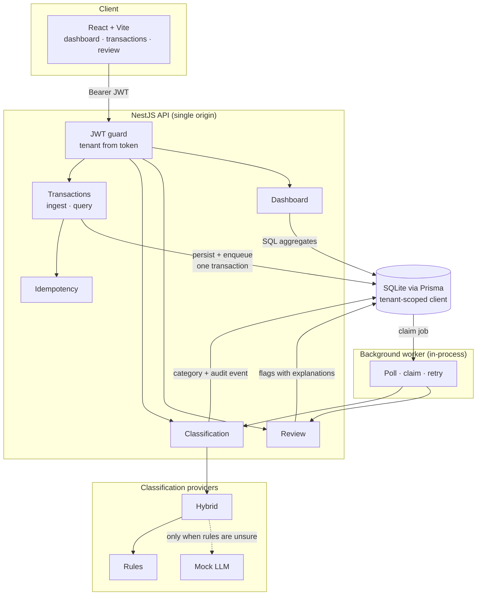

# Transaction Intelligence Platform

A multi-tenant platform for Nigerian businesses to import financial transactions, categorise them
automatically, surface the ones that need a human, and correct the machine when it is wrong —
without ever losing the record of what it originally decided.

Built for the Sycamore Capital technical assessment. Node.js + TypeScript throughout, SQLite so it
runs from a clone with nothing else installed.

---

## Quick start

```bash
git clone https://github.com/Kanye08/transaction-intelligence-platform.git
cd transaction-intelligence-platform
npm install
npm run setup     # migrate, build, seed ~1,850 transactions, classify them
npm start         # http://localhost:3000
npm test
```

`npm run setup` takes roughly two minutes, most of it classifying the seeded ledger through the
real pipeline so the app is populated the moment it starts. Node 20.11+ (`.nvmrc` pins 24).

### Demo logins

Password for all four: `Password123!`

| Organisation | Email | Role |
|---|---|---|
| Lagos Foods Ltd | `ada@lagosfoods.ng` | Owner |
| Lagos Foods Ltd | `tunde@lagosfoods.ng` | Member |
| Abuja Logistics Ltd | `bola@abujalogistics.ng` | Owner |
| Abuja Logistics Ltd | `chidi@abujalogistics.ng` | Member |

Sign in as each to see that the two tenants share nothing.

### Commands

| Command | What it does |
|---|---|
| `npm run setup` | Migrate, build, seed, classify. Safe to re-run. |
| `npm start` | Production mode: API and compiled frontend on port 3000. |
| `npm run dev` | API on 3000 with watch, Vite on 5173 with a proxy. |
| `npm test` | Full suite: 197 tests. |
| `npm run test:unit` / `npm run test:e2e` | Unit only / integration only. |
| `npm run typecheck` | `tsc --noEmit` on both workspaces. |
| `npm run db:reset` | Drop, re-migrate, re-seed, re-classify. |
| `npm run db:classify` | Drain the job queue by hand. |
| `npm run db:studio` | Prisma Studio. |

API docs: **`/api/docs`** (Swagger UI) · **`/openapi.json`** (spec) · **`/api/health`**

---

## Architecture



**The shape of the thing.** Ingestion writes a row and schedules a job, in one database
transaction, and returns. Classification happens later, in a worker. That single decision is what
makes the AI provider's health irrelevant to whether a customer's transactions are accepted.

### Layout

```
backend/src/
  common/
    auth/          JWT guard (global), @Public, @CurrentUser
    domain/        categories, statuses, rules — the shared vocabulary
    filters/       RFC 7807 problem details
    money/         integer-kobo money utility  ← financial correctness lives here
    prisma/        PrismaClient wrapper + SQLite pragmas
    resilience/    circuit breaker, timeout, jittered backoff
    tenancy/       tenant-scoped Prisma client  ← isolation lives here
  modules/
    accounts/ auth/ dashboard/ health/ idempotency/ jobs/ review/ transactions/
    classification/
      providers/   rules · mock-llm · hybrid, behind one interface
      classification-state.ts        the lifecycle, written down once
      classification.service.ts      applies a decision, guarded by row version
      classification-correction.service.ts   manual corrections + audit history
  scripts/process-jobs.ts
backend/prisma/        schema, migration (with CHECK constraints), seed
backend/test/          integration suites
frontend/src/          api client, auth context, 4 screens, components
```

---

## Financial correctness

**₦12,999.75 is stored as the BigInt `1299975`** — integer kobo, in a `BIGINT` column. No monetary
value is ever a JavaScript `number`, because `0.1 + 0.2 !== 0.3` and a ledger cannot absorb that.

- Input arrives as a **decimal string** and is parsed digit-by-digit in
  [`money.ts`](backend/src/common/money/money.ts). `parseFloat` is never used. A numeric JSON
  amount is **rejected** rather than accepted — by the time it is a `number`, the precision is
  already gone.
- Fractional kobo (`12999.754`), thousands separators, currency symbols and exponent notation are
  all refused at the edge, because silently rounding somebody's money is worse than a 400.
- Sums and averages stay in `BigInt`. `allocate()` distributes remainders a kobo at a time so
  split amounts always add back to the original.
- Every API response carries the amount three ways and **never as a number**:

```json
{ "amount": "12999.75", "amountMinor": "1299975", "currency": "NGN", "formattedAmount": "₦12,999.75" }
```

- `amountMinor` is a **string**: JSON has no integer type wide enough, and `JSON.stringify` cannot
  serialise `BigInt` at all.
- The only floating point in the system is in the *anomaly statistics* — a standard deviation used
  to decide whether to flag. It decides, it never produces a monetary value.

39 unit tests cover this, including values beyond `Number.MAX_SAFE_INTEGER` and the classic
`0.1 + 0.2` drift.

---

## Multi-tenancy

The tenant comes from the **verified JWT**, never from a path, query string or body. Requests that
pass `?organisationId=...` are ignored, and there is a test that proves it.

Isolation is enforced in one place: [`tenant-prisma.service.ts`](backend/src/common/tenancy/tenant-prisma.service.ts)
returns a Prisma client extended so that every operation on every tenant-owned model has the
organisation filter **injected into the `where`, and the tenant id overwritten in the `data`**.
A service cannot forget the filter, because the only way to reach tenant data is through a client
that already carries it; and if a service passes the *wrong* tenant id, the scope overwrites it.
Prisma's own types still require `organisationId` on writes, so the compiler stops you omitting a
tenant and the runtime stops you naming the wrong one.

Unknown operations throw rather than running unscoped — a new Prisma method cannot silently
bypass the boundary.

Cross-tenant requests return **404, not 403**: a 403 confirms the record exists.

Also implemented: bcrypt hashing, login rate limiting, Helmet headers (with a CSP carve-out only
for the Swagger page), whitelist validation that rejects unknown fields, problem-details errors
that never leak stack traces, and request correlation ids on every response and log line.

---

## Classification

Three interchangeable providers behind one interface
([`classification-provider.ts`](backend/src/modules/classification/providers/classification-provider.ts)):

| Provider | What it is |
|---|---|
| `rules` | ~90 deterministic Nigerian keyword rules — MTN, IKEDC, DSTV, FIRS/PAYE, GTBank charges, Paystack/Flutterwave settlements, AWS, Air Peace, salary, rent, stamp duty. Free, instant, reproducible. |
| `mock-llm` | A stand-in model. Deterministic semantic inference, and configurable misbehaviour: latency, timeout, failure, 429, invalid output, low confidence. |
| `hybrid` *(default)* | Rules first; the model only when rules are unsure. |

Switch with `CLASSIFICATION_PROVIDER=rules|mock-llm|hybrid`. Nothing else changes — ingestion, the
worker, the audit trail and the API know only the interface.

**The hybrid path:** run the rules → if confidence ≥ `CLASSIFICATION_CONFIDENCE_THRESHOLD` (0.75)
stop, no model call → otherwise call the model behind a timeout and a circuit breaker → validate
the response strictly → take it only if it beats the rule result. In the seeded data **roughly 8
in 10 transactions never reach the model**.

**Every provider response is validated** against the category list and a 0–1 confidence before it
can touch the database. A hallucinated `CRYPTO_SPECULATION` or `"confidence": "very high"` becomes
a handled provider failure, not corrupt data.

**Statuses:** `PENDING` → `CLASSIFIED` (confident) / `PROVISIONAL` (below threshold, stays
reviewable) / `FAILED_RETRYING` (provider degraded, another attempt scheduled) / `MANUAL` (a human
decided — automation may never touch it again). Transitions are enforced in
[`classification-state.ts`](backend/src/modules/classification/classification-state.ts).

Low-confidence results are **not** dumped into `Other` to look finished; they keep the best
available answer, are marked provisional, and are flagged for review.

### When the provider misbehaves

Timeouts, bounded retries, exponential backoff **with full jitter** (without it, every job that
failed during an outage retries at the same instant and recreates the outage), a circuit breaker
that stops hammering a dead provider, and dead-lettering after the attempt limit. A provider
failure never damages a stored transaction: it stays retrievable, with whatever is known so far.

Tests drive each failure mode through the real pipeline — `failure`, `timeout`, `rate_limited`,
`invalid` — and prove the system recovers automatically when the provider returns.

### Background jobs

A `jobs` table and a poll loop. Claiming is atomic (`UPDATE ... WHERE id = ? AND status =
'PENDING'`, not `SELECT` then `UPDATE`), so two workers cannot take the same job. Jobs left
`PROCESSING` by a crash are re-queued on boot.

**This is an assessment-scale queue, and I would not run it at volume.** It avoids making Redis a
prerequisite for `git clone`. [`jobs.service.ts`](backend/src/modules/jobs/jobs.service.ts) is the
seam: swapping in BullMQ, SQS or RabbitMQ replaces the worker and the enqueue call, and nothing
above them changes.

---

## Auditability

`classification_events` is append-only. Every decision — automated or human — records the previous
and new category, the source (`RULES`/`LLM`/`MANUAL`), confidence, provider and version, the actor,
a reason, and a timestamp.

A manual correction preserves `originalCategory` (the machine's first answer, kept forever),
records who changed it and why, and sets the status to `MANUAL`. **A classification job queued
before the correction cannot undo it** — the worker checks the status and the row version, and a
stale job is skipped. There is a test for exactly that race.

Correcting a category also closes the low-confidence flag that asked for the decision.

---

## Review

Four independent detectors, each separately testable, each producing a plain-English explanation:

| Rule | What it looks for |
|---|---|
| `DUPLICATE_SUSPECTED` | Same account, amount and direction within 24h under a *different* reference, with a similar description (Jaccard ≥ 0.6). Not the exact duplicate the unique index already rejects — this is the double-paid invoice. |
| `UNUSUALLY_LARGE` | More than 3σ above the mean of the last 120 comparable transactions **on the same account and direction**, and only once there are ≥ 20 of them. With five transactions of history, "unusual" is meaningless. |
| `LOW_CONFIDENCE` | Confidence below 0.6. Status alone doesn't flag: a 0.68 answer is reasonable, and a queue full of noise gets ignored. |
| `UNUSUAL_FREQUENCY` | More than 5 payments to the same counterparty in 24h — a retry loop or duplicated billing. |

All thresholds are environment variables. Flags are `UNIQUE(transactionId, rule)`, so detection is
idempotent and re-runnable. Lifecycle is `OPEN → RESOLVED | DISMISSED`, recording who closed it,
when, and their note.

The seeded data triggers all four, so the review queue is useful immediately (~104 open flags for
Lagos Foods: 76 low-confidence, 15 unusually large, 10 duplicates, 3 frequency).

---

## Transactions

- Single and batch import (≤ 500 rows), filtering, search, cursor pagination.
- **Duplicate prevention is a database guarantee**: `UNIQUE(organisationId, accountId,
  externalReference)`. Not a check-then-insert, which loses to concurrency. Five simultaneous
  imports of the same transaction produce exactly one row and four `DUPLICATE` responses — tested.
- **Idempotency-Key** on ingestion, resting on `UNIQUE(organisationId, key)`. Replays the original
  response; a reused key with a different payload is `409`; a failed request releases the key.
- **Batch ingestion has partial success.** Rows are validated individually — deliberately *not* by
  the global pipe, which would reject the whole batch for one bad row — and each returns `CREATED`,
  `DUPLICATE` or `FAILED` with its own error. HTTP `207`.
- **Cursor pagination**, keyed on `(transactionDate, id)`: page 10,000 costs what page 1 costs,
  where `OFFSET` would make the database walk every skipped row. Totals are opt-in
  (`includeTotal=true`) because counting a whole tenant is the expensive half of the query.

---

## Database

8 tables, 20 indexes, real constraints. SQLite has no Prisma enums, so the initial migration
hand-writes **CHECK constraints** for `amountMinor > 0`, direction, classification status and
source, confidence ∈ [0,1], flag severity and lifecycle, and job status. The database — not just
the application — refuses an invalid state. (Verified: inserting `direction = 'SIDEWAYS'` fails.)

**SQLite's limits, honestly:** one writer at a time, no `ILIKE`/trigram search, no partial indexes,
no native enums, and `synchronous = NORMAL` is set to keep seeding tolerable. Moving to PostgreSQL
means: change the datasource, convert the string-plus-CHECK columns to native enums, make search
`mode: 'insensitive'` or a trigram index, and swap the job table for a real queue. No application
code changes, because all database access already goes through the scoped client.

---

## Testing

**197 tests, all passing** (`npm test`), across 13 suites.

| Area | Coverage |
|---|---|
| Money | 39 tests: parsing, formatting, fractional kobo, huge values, floating-point drift, allocation |
| Tenant isolation | Cross-tenant read/update/delete/aggregate, spoofed org ids, forged tokens, 404-not-403 |
| Ingestion | Duplicates, concurrent imports, idempotency (replay / conflict / release / concurrency), partial batches |
| Classification | Full pipeline, every provider failure mode, circuit breaker, recovery, restart, dead-lettering |
| Audit | Original preserved, actor recorded, stale job cannot overwrite a manual correction |
| Review | Each of the four rules, insufficient-history guard, idempotent detection, flag lifecycle |
| Dashboard | Exact totals to the kobo, date and account filters, empty periods, tenant isolation |

Integration tests run the real application — same modules, pipes, guards and filter — against a
real migrated SQLite database. Nothing is mocked except the AI provider, which is a mock by design.

---

## Design scenarios

### 1. The classification provider is unavailable for six hours

Nothing stops. Ingestion never calls the provider: it writes the transaction and a job in one
transaction and returns `201`. Customers keep importing, and every transaction stays queryable with
`PENDING` or `FAILED_RETRYING` against it, so the ledger is complete even though the categories are
not.

The queue absorbs the backlog durably — it is a database table, so a restart loses nothing. Retries
are bounded with exponential backoff and full jitter, so a few hundred thousand jobs do not
stampede the provider the moment it recovers. After five consecutive failures the circuit breaker
opens and calls fail fast instead of burning a timeout each: during the outage the provider is
called a handful of times, not hundreds of thousands. Hybrid degrades rather than failing —
deterministic rules still classify most transactions, and the rest keep the best available answer
marked provisional.

Recovery is automatic: the breaker half-opens, one probe succeeds, and the backlog drains in
`runAt` order. Jobs are idempotent (classification is a pure function of the row plus a version
check), so a retry cannot double-apply. At real volume I would add: a queue-depth and
oldest-pending-job alert, a dashboard banner telling customers categorisation is delayed, and a
drain rate-limit so the recovery does not take the provider down again.

*Implemented here:* decoupled ingestion, durable jobs, bounded retries with jitter, circuit
breaker, automatic recovery, restart recovery — all under test.

### 2. Minimising classification cost at millions of transactions a day

The cheapest LLM call is the one you do not make. The hybrid provider runs deterministic rules
first and only escalates when confidence falls below the threshold; on the seeded ledger that is
**about 20% of transactions**, an 80% cost reduction before any other optimisation.

Beyond what is built, in order of return:

1. **Merchant caching.** Transaction descriptions repeat relentlessly — the same 200 merchants
   cover most volume. Cache `(normalised merchant, direction) → category` and the hit rate makes
   most of the remaining 20% free. Invalidate when a human corrects that merchant.
2. **Promote corrections into rules.** Every manual correction is a labelled example; a recurring
   one becomes a deterministic rule, and that merchant never costs a call again. The audit trail is
   already the dataset.
3. **Batching.** Classify 50 transactions per request rather than one — amortises the prompt
   overhead, which is most of the token cost on short inputs.
4. **Model tiering.** A small cheap model for ordinary transactions, the expensive one only for
   genuinely ambiguous or high-value ones. Confidence decides.
5. **Prompt economy.** Send the description, merchant, direction and amount band — not the whole
   record.
6. **Budgets and monitoring.** Cost per 1,000 transactions as a tracked metric, with a cap that
   degrades to rules-only rather than overspending.

Accuracy does not suffer, because the transactions that skip the model are the ones a rule already
identifies with high confidence — and the confidence threshold is the dial for that trade-off.

### 3. Scaling from 100,000 to 10 million transactions a day

**What is already right:** tenant-scoped queries with composite indexes, cursor pagination, SQL
aggregates rather than in-memory sums, opt-in counting, decoupled async processing, and stateless
JWT auth that scales horizontally.

**What has to change:**

- **PostgreSQL.** SQLite allows one writer; 10M/day is ~115 writes/second sustained with far higher
  peaks. Same Prisma schema, native enums, real concurrency.
- **Partitioning.** Range-partition `transactions` by month. Most queries are recent-window, and
  partition pruning keeps them fast while old data is detached and archived cheaply.
- **A real queue.** BullMQ or SQS, with many worker processes. A polling table becomes contention;
  `jobs.service.ts` is the seam.
- **Horizontal workers.** Classification is embarrassingly parallel. Scale on queue depth.
- **Read replicas** for the dashboard and listings, with the primary kept for writes. Aggregates
  tolerate replica lag.
- **Pre-aggregation.** Dashboard sums over 10M rows/day should be materialised per
  tenant/day/category and read in milliseconds, not computed per request.
- **Connection pooling** (PgBouncer) — serverless Prisma clients exhaust connections quickly.
- **Backpressure.** Rate limits per tenant, bounded queue depth, `429` with `Retry-After` rather
  than tipping over.
- **Observability.** The correlation id is already threaded through; it needs OpenTelemetry traces,
  per-tenant latency and error metrics, and alerts on queue depth and classification accuracy.
- **Retention.** Hot 90 days, warm to a year, cold to object storage.

Honest ordering: PostgreSQL and a real queue first, pre-aggregation second, partitioning only when
the table size demands it. Load-test each step rather than assuming.

### 4. A customer's finance team no longer trusts the dashboard

**Investigate with evidence, not reassurance.** The audit trail already answers the key questions
per transaction: what the machine decided, which provider and version, with what confidence, and
what a human changed it to. I would pull their corrections over the period and group them — a trust
problem is rarely uniform, it is usually one merchant or one rule systematically wrong. If 60% of
corrections are one counterparty, that is a one-line rule fix, not an AI problem.

**Fix in layers.** Immediately: add deterministic rules for the merchants they are correcting, so
the error cannot recur. Then raise the confidence threshold for that tenant, which routes more
transactions to review — slower, but trustworthy, and trust is what is broken. Then re-run
classification over the affected period; manual corrections are protected from being overwritten,
so their work is never lost.

**Make the system legible.** Every classification already carries a human-readable reason and a
confidence score, both surfaced in the UI; provisional categories are visibly marked rather than
presented as fact. A finance team that can see *why* a transaction was categorised, and that
"Utilities — matched 'IKEDC'" differs from "Other — model was unsure", stops experiencing the tool
as a black box.

**Then prove it.** Report correction rate as a tracked metric, per tenant and per category, and
show it falling. Add an alert when corrections for a category exceed a threshold, so the next
regression is found by us rather than by the customer.

*Implemented here:* append-only history, preserved original, protected manual corrections, reasons
and confidence on every decision, configurable thresholds, a review queue, reclassification that
respects human decisions.

---

## Known limitations

Deliberate, given the prototype scope:

1. **SQLite and an in-process worker** are assessment-scale. Covered above.
2. **The AI provider is a mock.** A real one is an implementation of a one-method interface; the
   failure handling around it is real and tested.
3. **Roles are thin** — `OWNER`/`MEMBER` exist but are not enforced as distinct permissions. Tenant
   isolation, which is the security property that matters here, is enforced and tested.
4. **No refresh tokens.** A 12-hour JWT and client-side logout; a denylist would go where the
   logout endpoint is.
5. **Search is `LIKE`-based.** Fine for seeded volumes, not for millions — needs trigram or a
   search index.
6. **No UI for importing transactions** — ingestion is exercised through the API and tests. The UI
   covers the three screens the brief asks for.
7. **Dashboard aggregates are computed per request.** Correct and indexed, but pre-aggregation is
   needed at volume.
8. **No E2E browser tests.** The API contracts behind every screen are integration-tested; the
   rendering is not.

## What production would need beyond this

Secrets in a managed store rather than `.env`; TLS and a reverse proxy; structured log shipping
with OpenTelemetry traces; per-tenant rate limits and quotas; database backups with tested restore;
blue/green deploys with migration gating; an on-call runbook for provider outages and queue
backlogs; SOC2-shaped access logging on financial records; and a data-retention policy.
